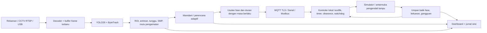

# Rancangan Edge-AI untuk simpang adaptif YOLO26

Dokumen teknis, 16 November 2026. Rekomendasi awal: **YOLO26n + ByteTrack pada Jetson Orin Nano 8 GB, TensorRT FP16**, dengan kontroler simpang yang menguasai urutan dan interlock lampu. Pemilihan akhir bergantung pada pengujian kamera, model, resolusi, dan perangkat yang benar-benar digunakan. Angka durasi dan bobot di bawah adalah parameter eksperimen simulator.

Workspace saat ini menjalankan rekaman CCTV → pengamatan YOLO26/ByteTrack → Mamdani → simulator. Contoh di `examples/edge_density` juga dapat mengirim usulan melalui HTTP lokal ke halaman `/edge.html` pada versi 0.3.1. Halaman Edge menggunakan simulator kendaraan existing dengan pengendali presence tersendiri. Dashboard utama belum menerima RTSP/USB; MQTT belum memiliki adapter penerima dan perangkat fisik belum terhubung. Contoh tersebut tidak mengganti satuan masukan atau aturan Mamdani SRS yang sudah ada.

## 1. Arsitektur dan tanggung jawab



Edge mengukur dan mengusulkan. Kontroler lokal menjadi satu-satunya penentu keluaran: peta konflik, minimum hijau, batas hijau, kuning, semua merah, kebutuhan pejalan kaki, pengecekan umpan balik, dan rencana cadangan. Jam kontroler tetap berjalan saat Python, GPU atau jaringan berhenti. Sediakan UPS, penyimpanan konfigurasi berversi, watchdog, dan pemulihan layanan setelah reboot. Internet/cloud hanya untuk pemantauan atau pengelolaan model; operasi simpang tetap lokal.

ESP32/Arduino cocok sebagai kontroler demonstrasi atau gateway. Pada instalasi lapangan, gunakan pengendali APILL atau PLC beserta perangkat interlock/monitor konflik dan rangkaian keluaran yang disetujui untuk lokasi tersebut. JSON dari Python tidak langsung memetakan pin relay. Pemilihan pengendali, pin, dan register harus mengikuti perangkat serta rekayasa simpang yang nyata.

## 2. Model, perangkat dan deployment

| Perangkat | Titik awal rancangan | Keputusan berikutnya |
|---|---|---|
| Jetson Orin Nano 8 GB | YOLO26n, TensorRT FP16, satu pipeline kamera terlebih dahulu | Naik ke `s` bila recall kendaraan jauh belum memadai dan anggaran latensi/memori masih cukup |
| Orin NX | `n` atau `s`, decoder perangkat keras, pipeline per kamera | Ukur persaingan GPU, decode, memori dan suhu saat seluruh kamera aktif |
| Jetson Nano generasi lama | `n`, toolchain yang kompatibel dengan JetPack perangkat | Jangan menyamakan dukungan paket dan performanya dengan Orin Nano |
| Raspberry Pi 5 | `n`, bandingkan ONNX Runtime ARM64 dan NCNN | Target 10 FPS perlu dibuktikan; pilihan runtime dapat mengubah jalur postprocessing |
| Pi + akselerator Hailo | Model HEF untuk jenis akselerator yang sesuai | Verifikasi dukungan YOLO26, head, compiler, kuantisasi, dan runtime; berkas ONNX tidak otomatis dapat dijalankan langsung |

Pilihan di tabel adalah rekomendasi rekayasa, bukan hasil benchmark perangkat tersebut. Panduan resmi menjelaskan [deployment Jetson](https://docs.ultralytics.com/guides/nvidia-jetson/), [opsi Raspberry Pi/NCNN](https://docs.ultralytics.com/guides/raspberry-pi/), dan [kompilasi Hailo HEF](https://docs.ultralytics.com/integrations/hailo/).

YOLO26 menyediakan head one-to-many dan one-to-one. Pada API yang diverifikasi, prediksi bawaan memakai one-to-many + NMS; **pilih `nms=False` secara eksplisit** untuk one-to-one. Contoh Python melakukan ini pada pemanasan dan tracking, kemudian memeriksa metadata backend. Ekspor NMS-free umumnya menghasilkan `(batch, 300, 6)` untuk deteksi; confidence filtering dan asosiasi ByteTrack tetap diperlukan. Perhatikan batas jumlah keluaran pada adegan sangat padat. Menambahkan flag ketika memuat ONNX lama tidak mengubah graph; ekspor ulang checkpoint. Tidak adanya node NMS saja belum membuktikan pemilihan head. Beberapa format/runtime mempunyai fallback. [Panduan end-to-end resmi](https://docs.ultralytics.com/guides/end2end-detection/).

DFL-free adalah perubahan arsitektur regresi kotak, bukan parameter yang harus diaktifkan saat runtime. STAL (*Small-Target-Aware Label Assignment*) bekerja saat pelatihan untuk objek kecil. STAL tidak menciptakan detail kendaraan yang tidak tertangkap kamera. Perbaiki sudut dan resolusi kamera, uji input lebih besar atau crop area ujung antrean, lalu fine-tune pada kamera lokal. Bila memakai beberapa tile, tangani ID/duplikasi lintas tile serta biaya tambahannya. Ukur recall berdasarkan jarak atau sub-ROI, bukan hanya mAP seluruh gambar. [Arsitektur YOLO26](https://docs.ultralytics.com/models/yolo26/).

Ekspor contoh pada lingkungan yang sudah dipastikan kompatibel:

```python
from ultralytics import YOLO

# Kerjakan di salinan checkpoint pada folder staging, bukan menimpa artefak rilis.
model = YOLO("staging/yolo26n.pt")
model.export(format="onnx", imgsz=(384, 640), nms=False,
             opset=17, simplify=False)

# Jalankan pembuatan engine pada GPU target Jetson dan versi TensorRT target.
model.export(format="engine", imgsz=(384, 640), nms=False, quantize=16)
```

API contoh sesuai Ultralytics lokal `8.4.210`; kunci versi setelah kalibrasi. Engine TensorRT bergantung perangkat dan versi runtime; gunakan TensorRT dari JetPack yang sesuai. Mulai dari FP16. INT8 membutuhkan kalibrasi representatif dan pemeriksaan akurasi/head; jangan menganggap seluruh kombinasi TensorRT/JetPack mempertahankan jalur NMS-free. Perintah ekspor di atas adalah petunjuk deployment, belum dijalankan pada Jetson dalam pekerjaan ini. [Dokumentasi TensorRT](https://docs.ultralytics.com/integrations/tensorrt/).

## 3. Pengamatan per lengan dan pembobotan

Tandai polygon setiap pendekat/lajur, garis berhenti, garis keluar, arah kendaraan dan area hilir. Gunakan titik tengah bawah bounding box sebagai perkiraan titik kontak jalan. Koordinat ROI disimpan ternormalisasi terhadap frame asli; bounding box dari preprocessing letterbox harus dipetakan kembali ke frame asli sebelum pengujian polygon. Larang ROI ambigu atau tentukan aturan kepemilikan yang eksplisit.

ByteTrack mempertahankan ID dalam satu stream/sesi. Hitung satu ID satu kali dalam snapshot. Jangan menjumlahkan hitungan semua frame sebagai kendaraan baru. Counter kendaraan terlayani menggunakan perlintasan garis keluar sesuai arah dan deduplikasi ID. Reset tracker dan epoch sumber setelah reconnect, pergantian kamera atau lompatan waktu.

Bedakan keluaran berikut:

| Besaran | Makna |
|---|---|
| `presence_i` | Kendaraan terlacak yang saat ini berada dalam ROI |
| `Q_i` | Kendaraan yang memenuhi kriteria berhenti/antrean |
| `D_i = Σ w_class` | Beban berbobot dari kendaraan yang memenuhi definisi pengamatan yang dipilih |
| `W_i` | Waktu tunggu berdasarkan riwayat track yang sah |
| `served_i` | Kendaraan yang melintasi garis keluar sesuai arah |
| `quality_i` | Validitas, umur data, gangguan, dan tingkat estimasi |

Untuk antrean, gunakan jendela gerak dan hysteresis masuk/keluar berhenti agar ID yang bergetar tidak berganti status terus. Ukur kecepatan dalam meter/detik bila homografi dan kalibrasi jalan tersedia; threshold gerak pixel/normalisasi bergantung perspektif. Track hilang sementara boleh mempertahankan identitas dalam jangka pendek, tetapi ketidakadaan pengamatan tidak boleh menambahkan waktu tunggu teramati tanpa batas. Tandai estimasi dan jangan menganggap semua kendaraan teroklusi tetap terukur.

Contoh memakai kelas COCO: `2=mobil`, `3=motor`, `5=bus`, `7=truk`.

| Jenis | Bobot eksperimen |
|---|---:|
| Mobil | 1,00 |
| Motor | 0,25 |
| Bus | 1,80 |
| Truk | 2,00 |

Angka ini **bukan koefisien resmi PKJI**. Untuk SMP/EKR operasional, gunakan pedoman yang berlaku dan kalibrasi menurut tipe pendekat, geometri, komposisi, serta arus jenuh setempat. Rujukan penghitungan kapasitas: [PKJI 2023, Bina Marga](https://binamarga.pu.go.id/uploads/files/1942/09pbm2023-pedoman-kapasitas-jalan-indonesia-.pdf). Bila ingin menyebut kepadatan ternormalisasi, tentukan kapasitas tampung ROI `K_i` dan gunakan `rho_i = D_i/K_i`; `D_i` sendiri adalah beban, bukan kendaraan per kilometer.

**Batas contoh:** `edge_agent.py` menghitung presence berbobot. Ia belum menghitung antrean berhenti, waktu tunggu, atau kendaraan terlayani. Dashboard existing mempunyai jalur pengamatan SRS untuk metrik tersebut. Integrasi SMP ke Mamdani memerlukan perubahan domain dan kalibrasi ulang; jangan memasukkan SMP ke membership function yang didefinisikan dalam jumlah kendaraan tanpa perubahan konfigurasi.

## 4. Durasi adaptif dan fase

Rumus awal untuk eksperimen:

```text
D_i = Σ w_class, untuk ID unik yang memenuhi definisi antrean/presence
g_i = clip(g_min_i + k_D × D_i + k_W × W_i, g_min_i, g_max_i)
```

Misal `g_min=10 s`, `g_max=60 s`, `k_D=2 s/kendaraan ekuivalen`, `k_W=0,1 s/s`; beban 10 dan tunggu 40 detik menghasilkan 34 detik. Contoh runnable memakai `k_W=0` karena belum mengukur tunggu. Untuk aplikasi SRS, **pertahankan Mamdani** sebagai perencana: fuzzifikasi antrean dan tunggu → aturan min/max → centroid → clamp batas fase. Rumus linier ini alternatif baseline eksperimen, bukan pengganti Mamdani yang telah diterima secara otomatis.

Minimum/maksimum hijau saja tidak mencegah starvation. Terapkan urutan siklik terbatas, batas jumlah fase yang boleh dilompati, dan batas penundaan pelayanan. Contoh memakai empat gerakan eksklusif tanpa skip. Peta konflik nyata disusun per gerakan, termasuk belok dan pejalan kaki; dua lengan berseberangan tidak otomatis kompatibel.

```text
GREEN(i)
  saat hijau berakhir: ambil data segar, hitung dan bekukan durasi NEXT
  -> YELLOW(i), durasi penuh
  -> ALL_RED, durasi penuh dan pemeriksaan interlock
  -> GREEN(next), memakai durasi yang dibekukan
```

Pesan berulang tidak me-reset penghitung hijau aktif. TTL pengamatan diperiksa saat memilih durasi. Selama clearance, durasi pilihan dibekukan; paket baru memverifikasi bahwa sumber tetap sehat, bukan mengganti durasi tersebut. Saat penerapan, bila pengamatan terbaru tidak segar/valid, belum pulih, atau epoch berubah, gunakan durasi cadangan. TTL pengamatan lama tidak diperpanjang hanya karena ia pernah dipakai untuk memilih durasi. Usulan tidak boleh menunda clearance yang sedang berjalan. Simpan keputusan dan ACK penerapan secara terpisah agar pembatalan rencana adaptif menjadi cadangan terlihat.

Pada empat fase, `g_max=60`, kuning 3, semua merah 1 detik, batas jeda dari akhir hijau sendiri sampai hijau berikutnya adalah `3×60 + 4×(3+1) = 196 detik`. Ini contoh perhitungan simulator tanpa preemption/pejalan kaki tambahan, bukan jaminan untuk konfigurasi lain. Kuning dan semua merah fisik harus dihitung sesuai geometri, kecepatan pendekat dan ketentuan setempat. Bila laju kedatangan melampaui kapasitas pelayanan, pembatasan fase tidak menjamin antrean tetap terbatas. Tambahkan deteksi spillback hilir agar simpang tidak terus melepas kendaraan ke ruang yang penuh.

Kebijakan gangguan yang diusulkan: umur pengamatan >2 detik atau sumber tidak valid → selesaikan interval berjalan dengan aturan kontroler, lalu rencana siklik cadangan lokal; pulih setelah tiga pengamatan valid berbeda berjarak satu detik. Angka ini parameter konfigurasi, bukan karakteristik YOLO. Jalan kosong yang teramati sehat tetap valid bernilai nol; kamera tertutup/putus tidak diberi nilai nol. Kontroler sendiri harus dapat melaksanakan cadangan meski tidak ada pesan `invalid` dari edge.

## 5. Kontrak komunikasi

Kirim **usulan rencana** dan terima **ack penerapan + keadaan aktual**. Contoh runnable menyediakan stdout, publisher MQTT `traffic/sim/<intersection>/plan/proposed`, atau HTTP lokal ke simulator `/edge.html`. Penerima HTTP sudah diimplementasikan; adapter MQTT ke simulator/hardware belum tersedia.

Payload menyertakan schema, identitas simpang, sesi/epoch, nomor urut, checksum konfigurasi, frame sumber, waktu pembuatan, masa berlaku UTC, validitas/alasan, urutan fase dan batas durasi. Sebagai contoh, satu bus berbobot 1,8 menghasilkan `green_s=[13.6,10,10,10]` pada konfigurasi demonstrasi. `green_s` adalah kandidat per fase; kontroler hanya menerapkan kandidat yang relevan pada batas fase berikutnya.

| Transport | Rancangan |
|---|---|
| MQTT | TLS, autentikasi/ACL per simpang, QoS 1, `retain=False` untuk usulan, MQTT 5 Message Expiry; ACK aplikasi memuat `session_id`, `seq`, diterima/ditolak, alasan, fase aktual dan waktu diterapkan |
| Serial / RS-485 | Framing panjang + versi + payload + CRC, nomor urut, ACK, timeout; isolasi listrik dan pengujian gangguan sesuai instalasi |
| Modbus RTU/TCP | Register rencana sementara + sequence/commit + register ACK/status; gunakan peta register vendor, bukan alamat generik untuk langsung mengubah masing-masing lampu |

Penerima menolak konfigurasi tidak dikenal, urutan replay/duplikat yang tak sesuai, rencana kedaluwarsa, fase konflik dan durasi di luar batas. QoS 1 dapat menduplikasi pesan: penerapan harus idempotent. PUBACK broker tidak membuktikan lampu berubah. Sinkronkan UTC/NTP untuk deadline lintas perangkat dan gunakan jam monotonic untuk timer lokal. Saat offset jam tidak dapat dipercaya, tolak mode adaptif sampai pulih. LWT MQTT hanya menandai koneksi; ia bukan bukti kesegaran kamera. API penerbit menggunakan Paho v2, loop jaringan, TLS dan pemeriksaan publish. [Referensi Paho](https://eclipse.dev/paho/files/paho.mqtt.python/html/client.html).

## 6. Kendaraan darurat dan kondisi sulit

Model COCO umum tidak mempunyai kelas semantik ambulans/pemadam yang dapat dipakai untuk otorisasi darurat. Kumpulkan data lokal, anotasi dan fine-tune kelas khusus; pisahkan jenis kendaraan dari keadaan sedang merespons darurat. Validasi arah/lajur dan persistensi track. Padukan kandidat visual dengan sumber terotorisasi seperti dispatch/V2X, operator, atau deteksi lampu/sirene yang telah diuji. Logo atau warna kendaraan saja tidak cukup.

State machine tambahan: `REQUEST → VERIFY → CLEARANCE → SERVE → CLEARANCE → RECOVER`. Permintaan memiliki ID, lengan/gerakan, waktu kedatangan, prioritas, autentikasi dan TTL. Definisikan batas hold serta cara konfirmasi kendaraan keluar. Untuk permintaan bersamaan, kontroler menyelesaikan kebijakan prioritas yang disetujui, bukan menyalakan dua fase konflik. Setelah selesai, pulihkan pelayanan lengan yang tertunda. Preemption merupakan pengecualian terhadap batas tunggu siklus normal dan harus tercatat. Kuning/semua merah tidak dihilangkan untuk memaksa hijau langsung; konsep preemption dan priority dijelaskan dalam [manual FHWA yang diarsipkan](https://ops.fhwa.dot.gov/publications/fhwahop08024/chapter9.htm), sebagai referensi teknis, bukan regulasi Indonesia.

| Kondisi | Perlakuan |
|---|---|
| Malam / silau | Kamera WDR/low-light, exposure yang sesuai, data latih malam, kalibrasi confidence dan recall; peningkatan citra hanya jika validasi menunjukkan manfaat |
| Hujan / lensa kotor | Perawatan/pelindung lensa, data hujan/refleksi, pemeriksaan blur/kontras/occlusion; quality gate perlu dikalibrasi agar malam yang sah tidak dianggap rusak |
| Oklusi padat | Sudut lebih tinggi atau kamera tambahan; ByteTrack membantu asosiasi, tetapi tidak mengukur kendaraan yang sepenuhnya tertutup |
| Track hilang | Buffer terbatas, reset pada reconnect, tandai estimasi; jangan membawa ID atau waktu tunggu antar-epoch tanpa bukti |
| RTSP tertunda | Decoder perangkat keras, antrean aplikasi satu frame terbaru, timeout/reconnect; ukur buffer kamera/decoder yang tidak terlihat oleh antrean aplikasi |
| Hilir tersumbat | Gunakan occupancy hilir dan kebijakan block/spillback yang sudah disetujui kontroler |

OpenCV mendukung timeout buka/baca melalui backend tertentu, antara lain FFmpeg/GStreamer; dukungannya bergantung backend. Timestamp monotonic sesudah `read()` hanya mengukur sejak frame diterima decoder aplikasi. Ia bukan waktu exposure CCTV. Untuk latensi kamera-ke-keputusan yang nyata, gunakan timestamp RTP/RTCP yang dipetakan ke NTP atau metode visual tersinkron. Contoh file memakai indeks/FPS untuk pacing dan tidak dimaksudkan sebagai pembaca timestamp VFR yang presisi. [Properti VideoCapture](https://docs.opencv.org/4.x/d4/d15/group__videoio__flags__base.html).

## 7. Implementasi dan bukti

- [`edge_agent.py`](../examples/edge_density/edge_agent.py): capture thread dengan slot terbaru, pemanasan model, YOLO26 NMS-free, ByteTrack, bottom-center ROI, pembobotan, batas durasi, TTL dan publisher stdout/MQTT simulasi.
- [`config.example.json`](../examples/edge_density/config.example.json): empat gerakan eksklusif, ROI ternormalisasi dan parameter eksperimen.
- [`README contoh`](../examples/edge_density/README.md): perintah Windows dan opsi RTSP/USB/MQTT.
- [`test_edge_example.py`](../tests/test_edge_example.py): validasi geometri, deduplikasi, bobot, nol vs tidak tersedia, TTL, batas durasi dan transport bawaan.
- [`edge-density-smoke.json`](../validation/edge-density-smoke.json): inferensi CPU nyata lima frame pada video gambar publik berulang; terdeteksi bus kelas 5, track 1, bobot 1,8, usulan 13,6 detik; metadata memastikan backend NMS-free.

Versi 0.3.1 menambahkan [`edge_protocol.py`](../backend/edge_protocol.py), [`edge_bridge.py`](../backend/edge_bridge.py), [`edge-controller.js`](../dist/edge-controller.js) dan halaman [`edge.html`](../dist/edge.html). Konfigurasi, urutan, bobot, fase serta identitas dikunci per sesi. Relay mencatat usulan sebelum mengakuinya, menolak replay/ID frame berulang dan hanya memberi satu token pengendali. Konsumen mencatat keputusan, transisi, ACK penerapan dan keluaran sintetis. Retry event konsumen dideduplikasi; gagal jurnal atau heartbeat menghentikan sesi. Restart tidak menghidupkan kembali usulan tersimpan yang pernah valid.

Bukti tambahan: 68 uji JavaScript, 33 uji Python dengan inferensi nyata, lima kelompok browser Edge dan sembilan kelompok regresi dashboard utama lulus. [`edge-browser-check.json`](../validation/edge-browser-check.json) dan [`edge-integrated-inference.json`](../validation/edge-integrated-inference.json) membuktikan 65 frame inferensi NMS-free/ByteTrack, usulan berbobot, penerapan adaptif, kendaraan sintetis, jeda/lanjut, cadangan dan ekspor. [`browser-regression-edge-update.json`](../validation/browser-regression-edge-update.json) memuat regresi jalur Mamdani existing. Foto bus berulang dan profil fase dipercepat hanya menguji integrasi, bukan akurasi atau benchmark stabil.

ROI demonstrasi di [`edge-density-demo-zones.json`](../validation/edge-density-demo-zones.json) dan [`edge-browser-demo-config.json`](../validation/edge-browser-demo-config.json) tidak cocok untuk persimpangan nyata. MQTT broker/ACK penerima, RTSP kamera, USB, Jetson, emergency classifier dan perangkat lampu belum diuji. Simulator memerlukan tab aktif; hilangnya lease konsumen selama 5 detik atau restart backend menggagalkan sesi. Default agen tetap stdout, tanpa menghubungi jaringan.

## 8. Tahapan penerimaan

1. Anotasi data kamera lokal siang/malam/hujan/oklusi; pisahkan kalibrasi dari evaluasi. Ikuti kuota SRS yang ada: pasangan ROI/waktu, lintasan track dan penilai independen. Ukur kesalahan Q/W, served count per arah, recall kendaraan kecil, ID switch dan tingkat data tidak tersedia.
2. Ukur pipeline penuh pada perangkat target: decode, inferensi, tracking, snapshot, antrean transport, ACK kontroler; laporkan FPS efektif, p50/p95/p99, umur frame, ukuran input aktual, power mode, suhu, penggunaan memori dan dropped frames. Target SRS ≥10 FPS efektif pada sumber 1280×720 serta p95 frame-ke-snapshot ≤1 detik masih harus dibuktikan. Resolusi sumber berbeda dari resolusi input model.
3. Uji controller-in-the-loop: timeout, replay, duplikat, reboot, jam salah, GPU berhenti, kamera beku, lampu feedback gagal, urutan konflik dan pemulihan. Verifikasi minimum/maximum/clearance pada waktu yang benar-benar diterapkan.
4. Gunakan renderer yang terdeteksi model untuk closed loop visual. Rekaman tidak dapat berubah responsnya ketika lampu diubah; simulator keluaran terpisah tidak membuktikan dampak kebijakan terhadap arus dalam rekaman.
5. Kunci baseline setelah kalibrasi, lalu jalankan 15 pasangan adaptif vs tetap dengan kondisi setara, masing-masing 30 menit: 5 pemanasan dan 25 pengukuran. Laporkan confidence interval dan kegagalan, termasuk bila adaptif lebih buruk. Uji telemetri terdahulu bukan penerimaan visual.
6. Jalankan shadow mode pada lokasi sebelum memberi wewenang penerapan, kemudian commissioning bersama pemilik pengendali dan otoritas jalan. Rancangan ini belum menyatakan penerimaan lapangan.
